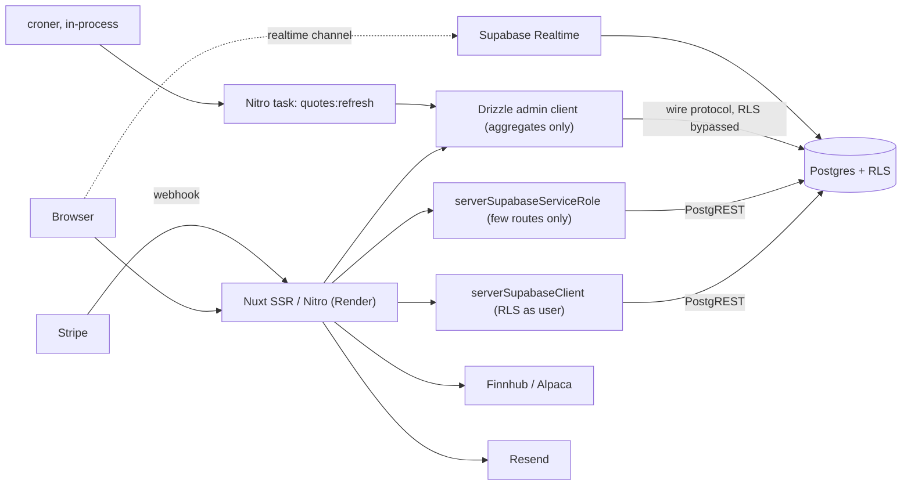
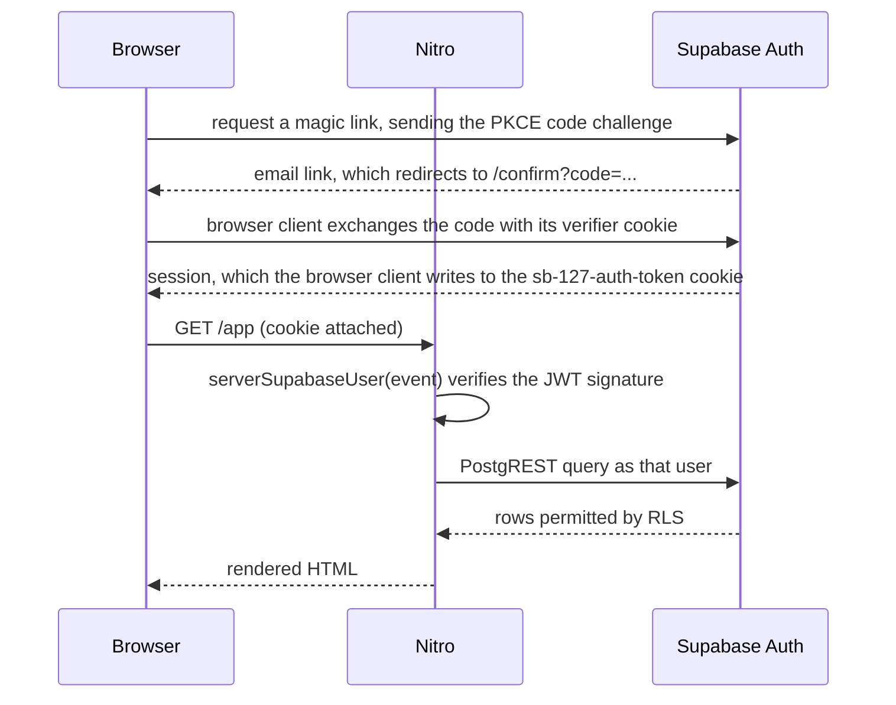

# Architecture

How the pieces fit together and how a request actually flows. Intent lives in
[plan.md](plan.md); the schema lives in [data-model.md](data-model.md).

## Shape of the system

A single Nuxt application serves both the rendered UI and the API. Nitro is the only
thing that talks to Supabase with elevated privileges; the browser never holds a secret.
Supabase provides Postgres, Auth, Realtime and Storage.



## Flows

One file per end-to-end path in [flows/](flows/), each verified against the running
stack and updated in the same commit as any change to its hops.

- [Request authorisation through RLS](flows/request-authorisation.md): how a Data API
  query becomes "only your rows" (Phase 1 M2)
- [Signup provisioning](flows/signup-provisioning.md): how a new user gets a profile,
  a personal organisation and an account in the signup's own transaction (Phase 1 M3)
- [Magic-link login](flows/magic-link-login.md): how a magic link becomes a session
  cookie that Nitro can verify on the next request (Phase 1 M5)

## The three data access paths

This is the most important rule in the codebase. An ORM connects over the Postgres wire
protocol as a privileged role and therefore **bypasses row level security silently** —
no error, just leaked rows. So each path has exactly one job:

**1. User-facing reads and writes — `serverSupabaseClient(event)`**

Goes through PostgREST carrying the user's JWT, so policies apply by construction. This
is the default and covers the large majority of routes. If a query can be expressed this
way, it must be.

**2. Deliberate privileged work — `serverSupabaseServiceRole(event)`**

Bypasses RLS. Allowed in exactly three places: the invitation flow, the Stripe webhook
handler, and organisation deletion. Every call site carries a comment naming why the
bypass is necessary. Any fourth use requires an entry in [decisions.md](decisions.md).

**3. Aggregates, scheduled tasks and reporting — Drizzle admin client**

Used where SQL expressiveness matters: equity curves, win-rate rollups, the nightly
price refresh. Also bypasses RLS, so every query must filter by `org_id` explicitly and
is never driven directly by user-supplied identifiers without a prior ownership check
through path 1.

Connection details: Render runs a persistent Node process, so the session-mode
connection is appropriate. If this ever moves behind the transaction pooler on port 6543,
`prepare: false` is mandatory for postgres.js or production fails with "prepared
statement already exists". Migrations always use the direct port 5432 connection.

## Authentication and session flow



The code exchange happens in the browser, not in Nitro: the module marks `/confirm` as
`ssr: false`, and the PKCE code verifier only exists as a cookie in the browser that asked
for the link. The full path is in [flows/magic-link-login.md](flows/magic-link-login.md).

`@nuxtjs/supabase` with `useSsrCookies: true` provides the cookie plumbing. These rules
follow from it:

- Client-side route middleware is **UX only**. It hides pages; it does not secure them.
- `serverSupabaseUser(event)` is the only trustworthy auth check on the server. It calls
  `getClaims()`, which checks the token's signature against Supabase's cached public keys
  and returns the claims, not a `User`. `serverSupabaseSession` is not trustworthy,
  because it reads the cookie without verifying it. A verified token stays valid until it
  expires, even after sign-out (ADR-0013).
- The server client reads the session from cookies only. It ignores an `Authorization`
  header, so a `curl` against a Nitro route needs the `sb-127-auth-token` cookie.
- A Supabase server client is created **per request**. A module-level shared client is a
  cross-request session leak.

All of this sits behind our own `server/utils/require-user.ts` and a `useAuth()`
composable, so the module stays swappable for raw `@supabase/ssr` later.

## Rendering strategy

Route rules make the rendering mode explicit rather than accidental:

```ts
routeRules: {
  '/':          { prerender: true },
  '/pricing':   { prerender: true },
  '/j/**':      { swr: 300 },                        // public shared journals
  '/api/og/**': { swr: 3600 },
  '/app/**':    { ssr: true, robots: false, cache: false },
}
```

Caveat worth knowing: on the `node-server` preset, `swr` caching is in-process or on the
filesystem. That is fine on a single instance. Multiple instances would need Nitro's
cache storage pointed at Redis.

## Server layer conventions

```
server/
  api/           trades/, accounts/, orgs/, invites/, billing/,
                 stripe/webhook.post.ts, og/[slug].get.ts
  db/            schema.ts (Drizzle tables), client.ts (admin client), generated/
  middleware/    request-context.ts (request id, logging)
  tasks/         quotes/refresh.ts
  utils/         require-user.ts, require-org-role.ts, errors.ts,
                 stripe.ts, email.ts, quotes.ts
```

- Every route begins with `requireUser(event)` and, where an organisation is involved,
  `requireOrgRole(event, orgId, roles)`.
- Input is validated with a schema at the boundary; handlers never read raw bodies
  directly except the Stripe webhook, which needs the raw body for signature
  verification.
- Errors are created through one helper in `utils/errors.ts`. This is deliberate: Nitro 3
  renames `statusCode` and `statusMessage` to `status` and `statusText`, and this keeps
  that a one-file change.
- No `event.node.*` access. Use `event.path` and `getRequestHeaders(event)` so the Nitro
  3 migration stays boring.

## Frontend layer conventions

```
app/
  pages/        index, pricing, login, confirm, j/[slug],
                accept-invite/[token], app/[org]/*
  middleware/   auth.global.ts (UX only), org-access.ts
  composables/  useAuth.ts, useOrg.ts, useTradeStats.ts, useLiveQuotes.ts
  components/   domain components grouped by feature, not by type
```

The active organisation lives in the route (`/app/[org]/...`), not in client state, so
that SSR, deep links and refreshes all behave. A server-side guard resolves the slug to a
membership and rejects non-members before any page renders.

## Shared code

```
shared/
  utils/        trade-stats.ts (P&L, win rate, R multiple), with its Vitest file
  types/        database.types.ts, generated by `npm run db:types`
  schemas/      trade.ts (Zod request bodies), with its Vitest file
```

Nuxt 4 auto-imports everything exported from `shared/utils/` and `shared/types/` into
both `app/` and `server/`, so the stats strip and any API response compute numbers with
the same functions. Code here is pure: no I/O and nothing Vue- or Nitro-specific. Exported
names become globals on both sides, which is why they are specific (`roundTo`, not
`round`). `shared/schemas/` is not auto-imported; routes import from
`#shared/schemas/...` explicitly. The generated types are regenerated after every
migration, and the Zod enums read `Constants` from them, so a new enum value reaches
validation without a hand edit.

## Async and background work

- **Scheduled**: `nitro.experimental.tasks` plus `scheduledTasks`. On the `node-server`
  preset, croner runs the schedule in-process, so behaviour is identical locally and in
  production.
- **Realtime**: a Supabase channel per organisation for the team activity feed, and one
  for open-position marks.
- **Streaming quotes**: a Nitro SSE endpoint proxies the price provider so the API key
  never reaches the browser. This is the same backend-for-frontend pattern as the earlier
  Netlify Functions work, done properly.
- **Email**: Resend, called only from Nitro, for invitations and the weekly summary.

## Environments

- **Local**: full Supabase CLI stack in Docker. `supabase db reset` replays all
  migrations plus `seed.sql` in seconds, which is what makes iterating on policies
  bearable.
- **Staging and production**: managed Supabase projects, with real auth redirect URLs,
  real email delivery and Stripe test keys in staging.
- **CI**: the local stack in GitHub Actions, giving a disposable database for the RLS test
  suite.

Hard rule: no schema change is ever made in the Supabase dashboard. If one happens by
accident, capture it with `supabase db diff` into a migration file before doing anything
else.
