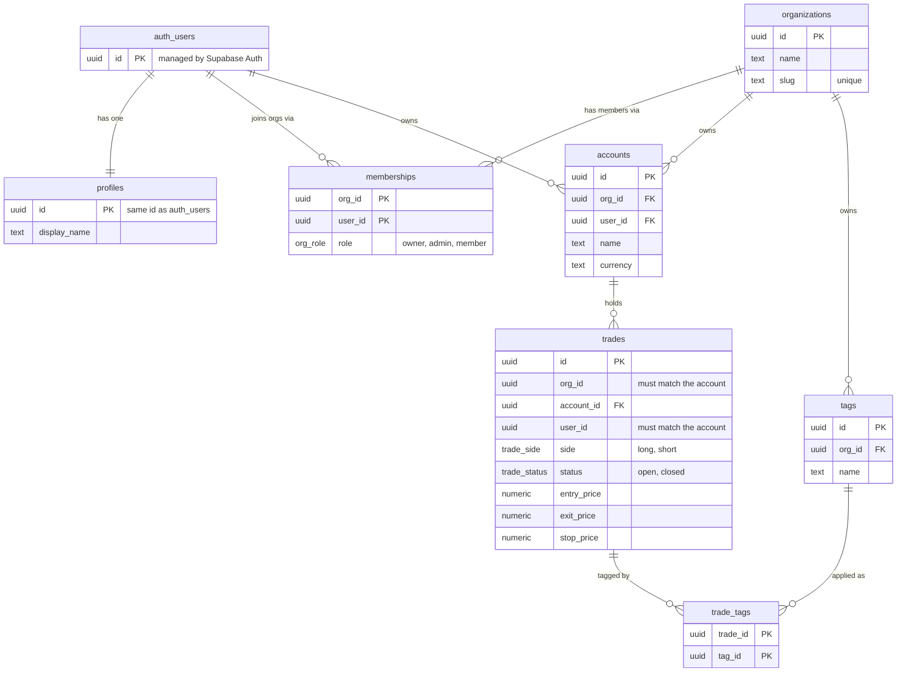
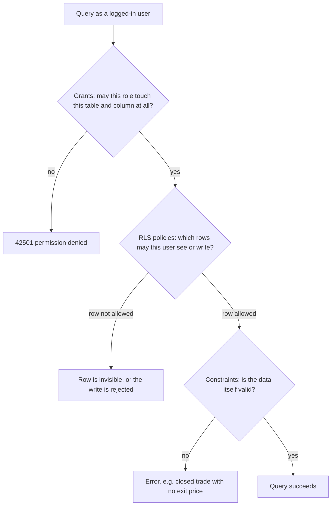

# Database architecture

A high-level picture of the Phase 1 database. Column-level detail lives in
[data-model.md](data-model.md); the reasoning lives in [decisions.md](decisions.md).

## The idea in one paragraph

Every piece of data belongs to an **organisation**. A user joins an organisation through a
**membership**, which carries their role (`owner`, `admin` or `member`). Inside an
organisation, each user has **accounts**, and each account holds **trades**. **Tags** are
shared within an organisation and attached to trades through **trade_tags**. Every child
table carries `org_id` directly, so every security rule can ask one cheap question: "is
this row's `org_id` one of my organisations?"

## Tables and relationships

`trades` has one foreign key covering `(account_id, org_id, user_id)` together. That means
a trade can only point at an account that is in the same organisation and owned by the
same person.

Deleting an organisation or a user cascades down through these relationships.

## How a request is checked

Three layers inside Postgres decide whether a query succeeds. They are independent, so
removing one does not open the door on its own.

- **Grants** are per role and per column. `anon` has none. `authenticated` cannot update
  `org_id` or `user_id` on anything.
- **Policies** use two helper functions in the unexposed `private` schema:
  - `my_org_ids()` returns every organisation you belong to.
  - `my_managed_org_ids()` returns the organisations where you are an owner or admin.

  Members see their own accounts and trades; owners and admins see everyone's in their
  organisations.

- **Constraints** (check constraints, foreign keys, uniqueness) apply to every writer,
  including the Drizzle admin client, which bypasses the other two layers.

## Where each part is defined

| Part                                | Defined in                                      |
| ----------------------------------- | ----------------------------------------------- |
| Tables, columns, constraints, index | `server/db/schema.ts`, generated by drizzle-kit |
| Grants, RLS, policies, helpers      | Hand-written SQL, same migration file           |
| Proof that isolation holds          | `supabase/tests/*.test.sql` (pgTAP)             |
