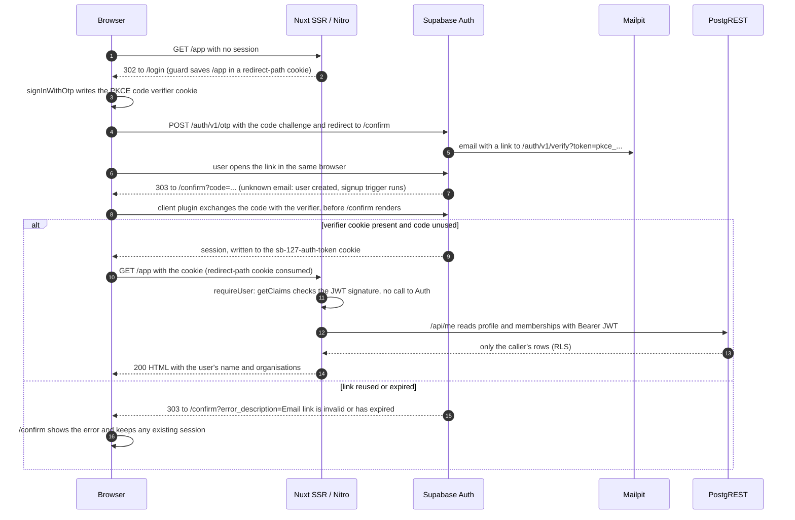

# Magic-link login

**Trigger**: someone enters their email on `/login` · **Outcome**: they land on the page
they were heading for, rendered on the server with their own data
**Status**: built in Phase 1 M5. Password sign-in for the seeded demo users replaces steps
3 to 8 with one `POST /auth/v1/token` and joins the path at step 9. Staging uses Supabase's built-in email sender instead of Mailpit (M8).
**Last verified**: 2026-10-09, in the browser against the local stack: a new address
through Mailpit, Sam through Mailpit, a reused link, and a deleted user's leftover cookie

## Sequence

## What each step guarantees

| Step  | Guarantee                                                                                             | Enforced in                                             |
| ----- | ----------------------------------------------------------------------------------------------------- | ------------------------------------------------------- |
| 2     | Signed-out visitors are sent to sign in. UX only: the data is protected by step 11 and RLS            | `redirect` options in `nuxt.config.ts`                  |
| 3–4   | The link only works in the browser that asked for it, because only that browser has the verifier      | PKCE in `@supabase/ssr`'s browser client                |
| 7     | Only redirect targets on the allow list are used; anything else falls back to `site_url`              | `additional_redirect_urls` in `supabase/config.toml`    |
| 8     | The code is exchanged by the browser, so `/confirm` never renders on the server                       | `ssr: false` route rule added by `@nuxtjs/supabase`     |
| 11    | A forged or tampered cookie is a 401; a valid token is trusted until it expires (ADR-0013)            | `server/utils/require-user.ts`                          |
| 12–13 | The server reads as the user, so RLS decides what the page can show                                   | `serverSupabaseClient(event)` in `server/api/me.get.ts` |
| 15–16 | A used or expired link cannot sign anyone in, and a failed attempt does not sign the current user out | Supabase Auth; `app/pages/confirm.vue`                  |

## Files involved

- `app/pages/login.vue`: the magic-link and password forms
- `app/composables/useAuth.ts`: every call into the Supabase client, including the
  redirect URL built from `runtimeConfig.public.siteUrl`
- `app/pages/confirm.vue`: reports the outcome of the exchange and returns to the saved
  path
- `nuxt.config.ts`: the guard's `include` pattern and `saveRedirectToCookie`
- `server/utils/require-user.ts` and `server/api/me.get.ts`: the first server-side read
- `supabase/config.toml`: `site_url` and the `/confirm` redirect URL

## Related

- [signup-provisioning.md](signup-provisioning.md): what step 7 sets off for a new email
- [request-authorisation.md](request-authorisation.md): what happens inside PostgREST at
  step 12
- [decisions.md](../decisions.md): ADR-0005 (the module behind our wrappers) and ADR-0013
  (verified JWT, no round trip)
- [security.md](../security.md): "Who are you?"
