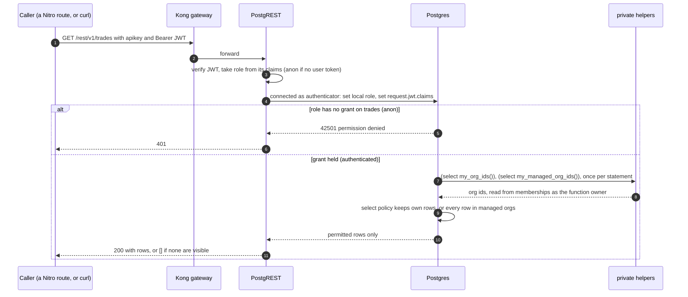
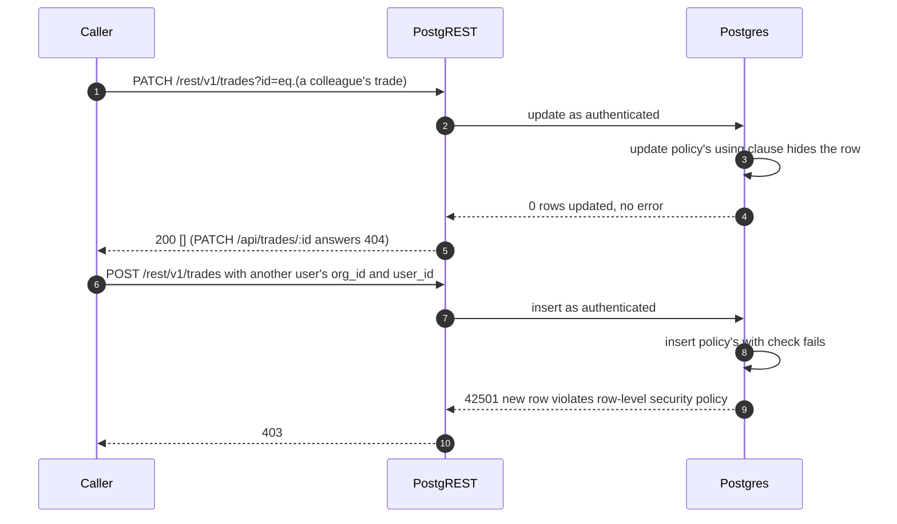

# Request authorisation through RLS

**Trigger**: a query arrives at the Data API · **Outcome**: only the rows this user may
see or write are touched
**Status**: built in Phase 1 M2. Since M6 the usual caller is a Nitro route under
`server/api/trades/`, which takes the JWT from the session cookie and turns the
outcomes below into 404, 403 and 422.
**Last verified**: 2026-10-09, against the local stack with `curl` through the Nitro
routes as Sam, Priya and Maya, and `supabase/tests/rls_tenancy.test.sql`

This flow shows the hops a request takes. The three checks inside Postgres (grants,
policies, constraints) are drawn as a decision tree in
[database-architecture.md](../database-architecture.md#how-a-request-is-checked).

## Reads

## Writes

Kong is omitted here; it only forwards.

`POST /api/trades` never reaches step 8 with a foreign `org_id` or `user_id`. The strict
Zod schema rejects both keys with 400, `user_id` comes from `requireUser`, and `org_id`
is copied from an account the caller owns. That check, the composite foreign key and
this policy are three separate layers guarding the same rule.

## What each step guarantees

| Diagram | Step | Guarantee                                                                      | Enforced in                                          |
| ------- | ---- | ------------------------------------------------------------------------------ | ---------------------------------------------------- |
| Reads   | 4    | The database sees the user's identity, never a privileged role                 | PostgREST role switch; `auth.uid()` reads the claims |
| Reads   | 5–6  | `anon` cannot touch core tables at all, before RLS is consulted                | `revoke all` and grants in the core migration        |
| Reads   | 7–8  | Tenancy is resolved once per statement, without recursing into memberships     | `security definer` helpers, `(select ...)` wrapping  |
| Reads   | 9    | Members see only their own trades, managers see their orgs (invariants 1–3)    | `trades: read own, or all if manager` policy         |
| Writes  | 3–5  | Someone else's row is invisible, not forbidden, so nothing leaks its existence | `trades: update own` policy                          |
| Writes  | 8–10 | A row cannot be written into another org or another user's name                | `with check` on `trades: insert own into own org`    |

The private helpers themselves are unreachable from the API: `POST /rest/v1/rpc/my_org_ids`
returns `PGRST202`, because the `private` schema is not exposed (invariant 6).

## Files involved

- `supabase/migrations/20260927170337_create_core_tables.sql`: grants, helpers, RLS and
  policies
- `server/db/schema.ts`: the composite foreign key that pins a trade's account to the same
  org and owner
- `supabase/config.toml`: `auto_expose_new_tables = false`, so a new table has no API
  grants until a migration adds them
- `supabase/tests/rls_tenancy.test.sql` and `supabase/tests/rls_catalogue.test.sql`: the
  proof
- `server/api/trades/*.ts` and `server/utils/errors.ts`: the Nitro routes in front of
  PostgREST, and `mapDatabaseError`, which turns `PGRST116`, `42501` and the constraint
  codes into 404, 403 and 422

## Related

- [security.md](../security.md): invariants 1 to 4, 6 and 7
- [decisions.md](../decisions.md): ADR-0010 (pgTAP) and ADR-0011 (explicit grants)
- [architecture.md](../architecture.md#the-three-data-access-paths): the Drizzle admin
  client bypasses this whole flow
