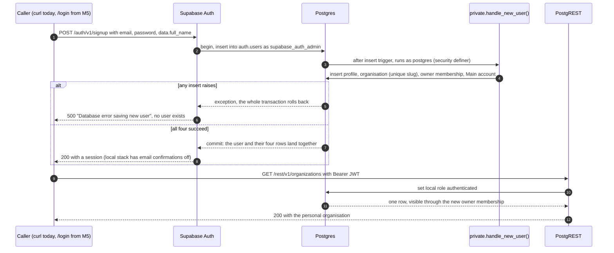
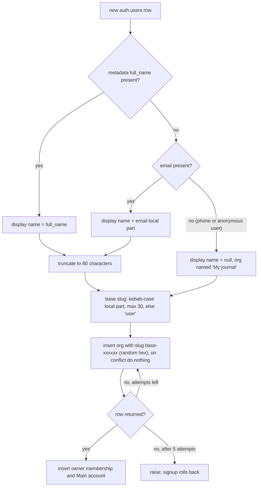

# Signup provisioning

**Trigger**: someone signs up with Supabase Auth · **Outcome**: on their first request
they already have a profile, a personal organisation they own, and a `Main` account
**Status**: built in Phase 1 M3. The `/login` page that starts the signup from the
browser arrives in M5; until then the caller is `curl`, `seed.sql` or a pgTAP test.
**Last verified**: 2026-10-09, against the local stack with `curl` to `/auth/v1/signup`
and `/rest/v1/*`, and `supabase/tests/signup_trigger.test.sql`. The rollback branch is
covered by reasoning and GoTrue's documented behaviour, not exercised.

No API role can insert into `organizations` or `memberships` (invariant 4), so a user
never creates their own tenancy. Postgres creates it, inside the same transaction as the
`auth.users` row, which means the user either exists with all four rows or not at all.

## Sequence

Kong is omitted; it only forwards.

## Inside the trigger

Every input is treated as untrusted and possibly missing, because any exception here
blocks the signup.

## What each step guarantees

| Diagram  | Step | Guarantee                                                                         | Enforced in                                       |
| -------- | ---- | --------------------------------------------------------------------------------- | ------------------------------------------------- |
| Sequence | 3    | Provisioning cannot be skipped by any client, including one calling GoTrue raw    | `on_auth_user_created` trigger on `auth.users`    |
| Sequence | 3–4  | The trigger can write tables that no API role may insert into                     | `security definer`, owned by `postgres`           |
| Sequence | 3–4  | Nothing in the caller's schema can shadow a table or function the trigger uses    | `set search_path = ''` and schema-qualified names |
| Sequence | 5–8  | There is never a user without an org, membership and account, or the reverse      | Same transaction as GoTrue's insert (ADR-0009)    |
| Sequence | 9–12 | The new user sees their own org and only that; `anon` still gets 401              | Grants and policies from the core migration       |
| Trigger  | slug | Slugs satisfy `organizations_slug_format` and don't reveal which names are taken  | Kebab-case plus random suffix, retry on conflict  |
| Trigger  | name | An unbounded `full_name` cannot exceed `organizations.name`'s 100-character limit | `left(..., 80)` before appending `'s journal`     |

`raw_user_meta_data` is client-controlled, so it only ever sets a display name, never a
role or an org. The trigger function itself is unreachable: `POST /rest/v1/rpc/handle_new_user`
returns `404 PGRST202`, and execute is revoked from `public`, `anon` and `authenticated`.

## Files involved

- `supabase/migrations/20261010002421_add_signup_trigger.sql`: the function, its grants
  and the trigger
- `supabase/migrations/20260927170337_create_core_tables.sql`: the tables, the missing
  insert policies on `organizations` and `memberships`, and the select policies the new
  user reads through
- `supabase/seed.sql`: signs up the demo users through the same insert, so seeded users
  are provisioned exactly like real ones, then renames Maya's org to `demo-desk`
- `supabase/config.toml`: `enable_confirmations = false` locally, which is why step 8
  returns a session; with confirmations on, it arrives after the email link (M5)
- `supabase/tests/signup_trigger.test.sql`: the proof, including phone-only signups,
  300-character names and colliding email local parts

## Related

- [decisions.md](../decisions.md): ADR-0009 (provision in a trigger) and ADR-0011
  (explicit grants)
- [security.md](../security.md): invariants 3, 4 and 6
- [database-architecture.md](../database-architecture.md#what-a-signup-creates): the four
  rows as a picture
- [request-authorisation.md](request-authorisation.md): what happens to the requests that
  follow
